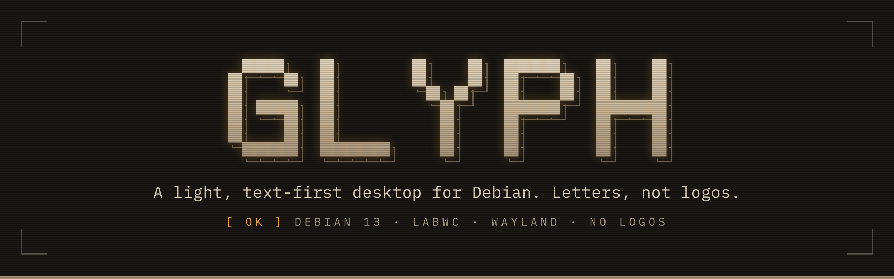
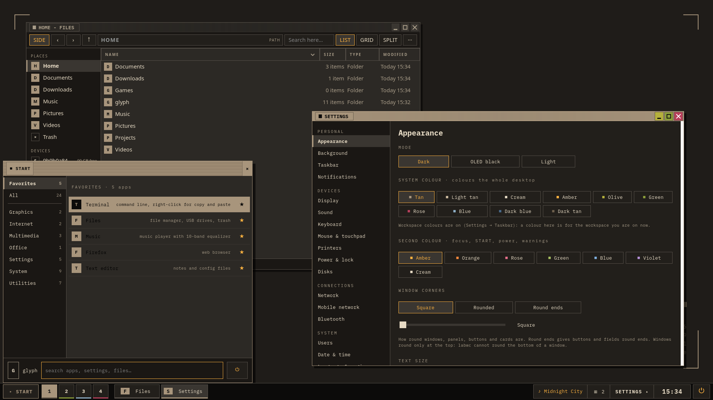
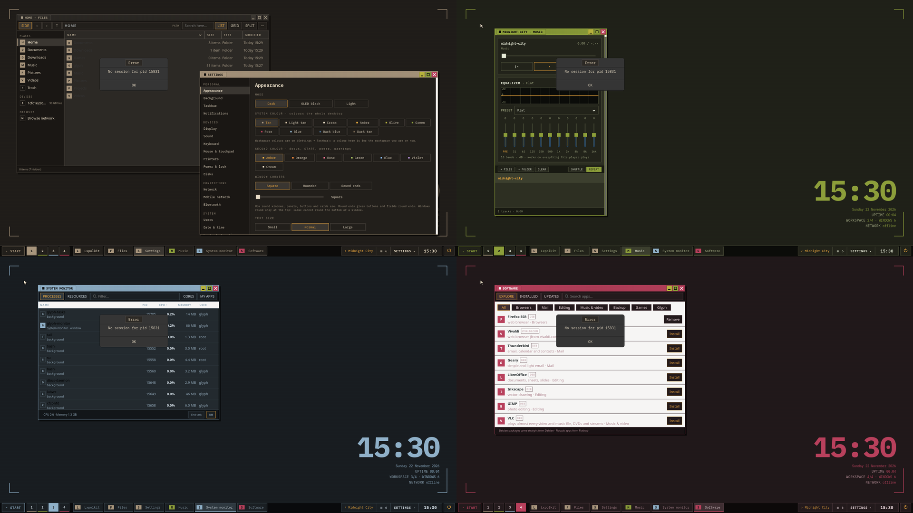
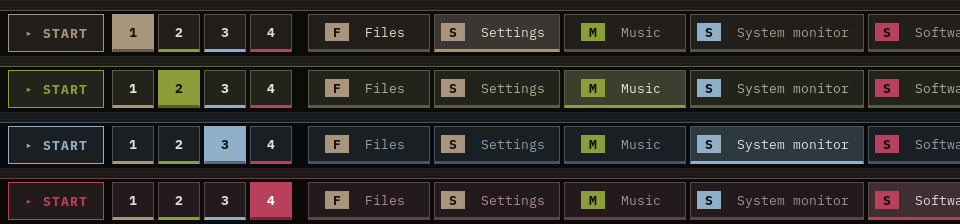
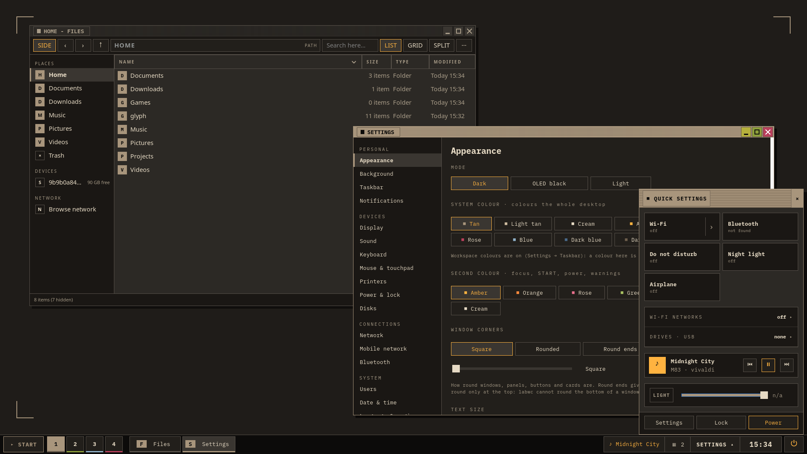
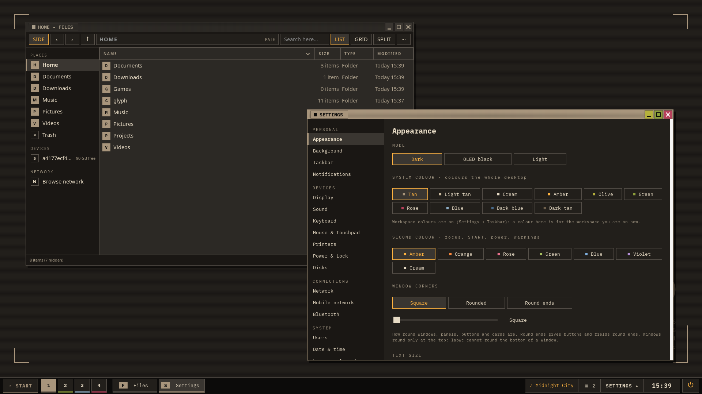
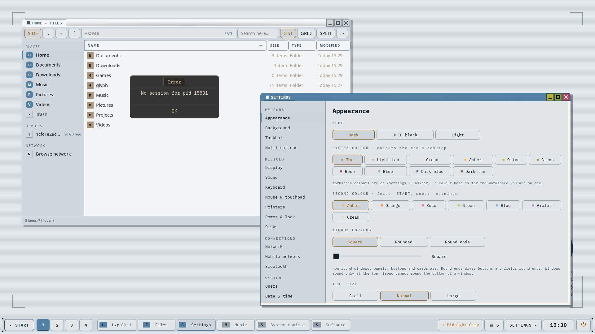
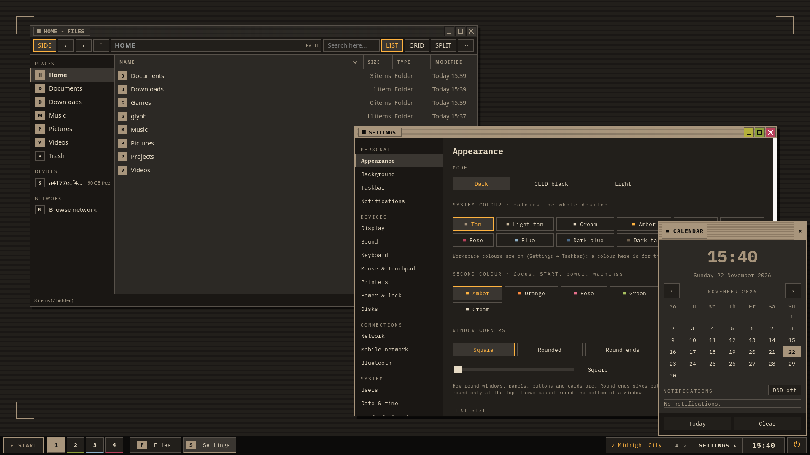
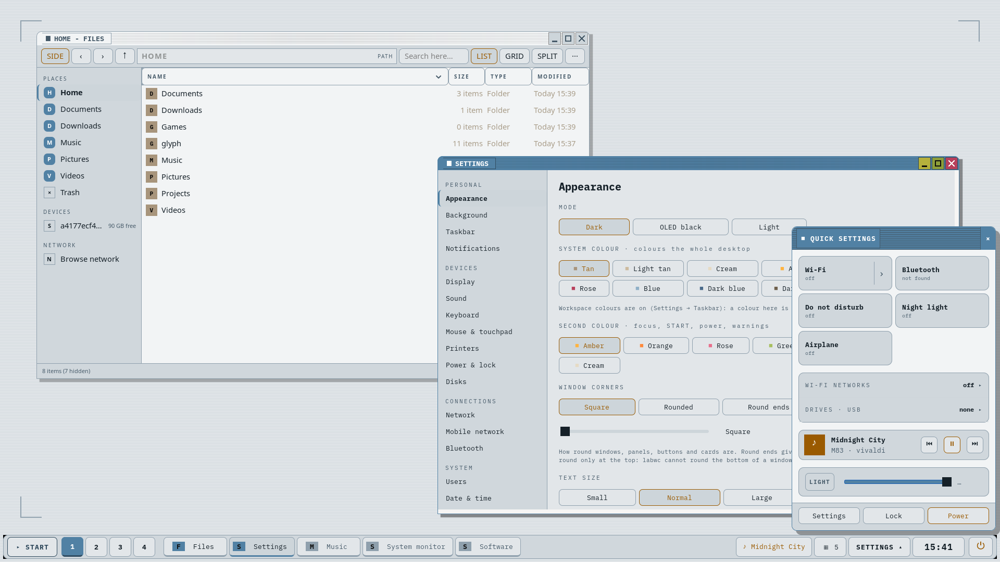
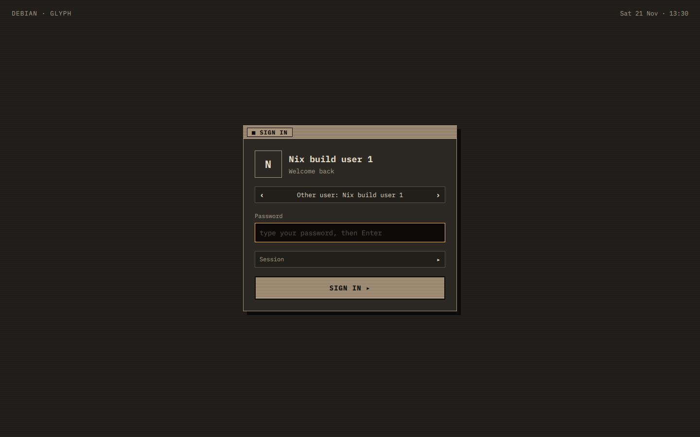

<div align="center">



**A light, text-first desktop for Debian 13. Letters, not logos.**

Debian 13 · labwc · Wayland · runs next to KDE, GNOME or XFCE · open source

[Why Glyph](#-why-glyph-is-different) · [Try it](#-try-it-next-to-your-desktop) · [What you get](#-what-you-get) · [Roadmap](#-roadmap) · [Change the look](#-change-the-look) · [Update](#-update-and-remove)

</div>

## What is Glyph?

Glyph is a complete desktop for Debian, put together from small open-source parts instead of one big desktop environment. Everything looks the same: one font, one shape and one set of colours.

- **Text first.** Apps get a letter tile (**F** Files, **T** Terminal), not a logo. Menus and buttons are words.
- **One look everywhere.** IBM Plex Mono and the Glyph colours: Dark, OLED black or Light, with ten system colours. Square, rounded or round corners. One settings file themes the windows, the taskbar, the panels and your apps.
- **Light.** labwc (Wayland) with a handful of small programs. No full desktop environment underneath.
- **Safe to try.** Glyph installs as an **extra session**. Your KDE, GNOME or XFCE stays exactly as it is, and `./uninstall.sh` removes Glyph again.

<div align="center">



<sub>The real Glyph session: start menu, Files, Settings and the taskbar. All screenshots on this page are made automatically on GitHub after a clean install on Debian 13.</sub>

</div>

## ◆ Why Glyph is different

Most desktops are built around icons, a big settings program and a look that apps only half follow. Glyph goes the other way.

| | Glyph | A typical desktop |
|---|---|---|
| **Apps and buttons** | A letter tile and a word: **F** Files, **T** Terminal, *Shut down* | An icon you have to learn |
| **Theme** | One choice colours *everything*: windows, taskbar, panels, start menu, GTK and Qt apps, the terminal, Firefox, Vivaldi, notifications, the lock screen and (optionally) boot and sign-in | Apps, browser and lock screen each do their own thing |
| **Workspaces** | Each workspace can have its **own colour**. The whole desktop takes it on when you switch, and every app on the taskbar shows the colour of its workspace. The taskbar shows only the apps of the workspace you are on | Numbered workspaces that all look the same |
| **Size** | labwc plus small programs; most of Glyph is short Python you can read and change | A larger set of programs and services |
| **Changes** | Almost every setting applies at once, without signing out | Some changes need a restart or sign-out |
| **Language** | English, or any language from one plain text file (`Shut down = Afsluiten`) that anyone can write | Translations made with special tools |
| **Look and feel** | A retro terminal look on purpose: striped title bars, a hard drop shadow, optional scanlines, a big clock on the desktop | A modern flat look |

A few smaller things that come with it:

- **Shutting down is polite.** Glyph asks every app to close and waits, so an unsaved drawing or document still gets its *Save?* question; *Shut down anyway* is there when you need it.
- **Your clipboard remembers** (Super+V), the start menu also finds settings and recent files, and quick settings show what is playing.
- **Software for people, not packages.** Glyph Software shows a short, curated list (browsers, office, games, backup…) and installs from Debian, Flathub or the maker's site.
- **No surprises.** USB sticks, a low battery and waiting updates show up as a notification, and nothing installs or updates without you saying so.

## ◐ A colour for every workspace

Turn on **Settings → Taskbar → Workspace colours** and every workspace gets its own colour. When you switch, *all* of Glyph takes it on: the title bars, the taskbar, the start menu, the panels and the clock on the desktop. The apps on the taskbar are the apps of that workspace, with their letter tile in its colour, so you always see where you are.

| Workspace | Colour (you can change each one) |
|---|---|
| **1** | your system colour (tan here) |
| **2** | green |
| **3** | blue |
| **4** | rose |



<sub>Workspace 1 with Files and Settings, 2 with Music, 3 with the System monitor and 4 with Software: one desktop, four colours.</sub>



Prefer one colour everywhere? Leave it off: then the system colour is used on every workspace.

## ✦ What you get

| Quick settings | Files and Settings |
|---|---|
|  |  |
| **Light mode, blue** | **Calendar** |
|  |  |

| Part | What it does |
|---|---|
| **Windows** | Windows with a striped, coloured title bar, **_ □ ×** buttons and a hard shadow; square, rounded or round corners. Drag a window to an edge for half the screen, or to the top to maximize it. Four workspaces. |
| **Taskbar** | At the bottom: ▸ START, workspaces, the apps of this workspace with a letter tile in its colour, ♪ now playing, ▦ open windows, SETTINGS ▴ (with the update count), the clock and POWER. Every part can be switched off in Settings → Taskbar. |
| **Start menu** | Categories on the left, apps on the right. One search box finds apps, settings and files. |
| **Quick settings** | Tiles for Wi-Fi, Bluetooth, do not disturb, night light, airplane mode and power profile; Wi-Fi, Bluetooth, drives, sound output, microphone and batteries in one list; now playing, volume and brightness at the bottom. |
| **Settings** | Appearance, background, taskbar, notifications, display, sound, keyboard, mouse, printers, power, disks, network, Bluetooth, users, date, language, privacy, default apps, accessibility, updates and about. |
| **Apps** | Glyph Files, Music, System monitor (Ctrl+Shift+Esc), Software, Disks, Calculator and Screenshot; text editor (Mousepad), terminal (Xfce Terminal), image viewer (Ristretto), video (mpv), PDF (Atril), Firefox. More in Software. |
| **Start-up** | Boot menu, splash screen, sign-in screen, a welcome at the first start, and a lock screen. |

<div align="center">



<sub>Light mode with rounded corners: the panels, the taskbar and the buttons follow the shape.</sub>

</div>

## ▶ Try it (next to your desktop)

```sh
sudo apt install git
git clone https://github.com/DRetro83/glyph
cd glyph
./install.sh --check   # optional: only shows what it would do
./install.sh
```

Then log out. At the login screen, pick **Glyph** in the session list (in SDDM it is bottom left) and sign in. To go back, log out and pick your old desktop again.

The first time, a short welcome helps you pick a look, connect to Wi-Fi and add apps.

| Sign-in screen (optional) | The HTML prototype Glyph is built from |
|---|---|
|  |  |

### Start-up look (optional)

The boot menu, the start-up screen and the sign-in screen are a separate step, because they change system files and also the sign-in screen that KDE uses:

```sh
extras/boot/install-boot.sh --check   # only shows what it would do
extras/boot/install-boot.sh           # GRUB + Plymouth + SDDM, or name only some: sddm grub plymouth
extras/boot/install-boot.sh --remove  # back to how it was
```

They take your Glyph colours at the moment you run it; run it again after you change the colour.

### Keys

| Do this | Keys |
|---|---|
| Start menu | tap Super, or Ctrl+Space, or click ▸ START |
| Clipboard history | Super+V |
| All shortcuts | Super+/ |
| System monitor | Ctrl+Shift+Esc |
| Power menu (lock, log out, restart, shut down) | click POWER, or Ctrl+Alt+Delete |
| Lock the screen | Ctrl+Alt+L or Super+L |
| Screenshot of the screen / an area | Print / Shift+Print (or Ctrl+Alt+P) |
| Open the desktop menu | right-click the desktop, or Ctrl+Alt+M |
| Terminal | Ctrl+Alt+T |
| Files | Super+E |
| Switch windows | Alt+Tab or Alt+Q |
| Left / right half | Super+← / → (or Ctrl+Alt+← / →), or drag to the edge |
| Maximize / restore | Super+↑ / ↓ (or Ctrl+Alt+↑ / ↓), or drag to the top |
| Close a window | Ctrl+Alt+W or Alt+F4 |
| Go to workspace 1–4 | Ctrl+Alt+1 … 4 |
| Move a window to workspace 1–4 | Shift+Ctrl+Alt+1 … 4 |
| Volume | volume keys, or Ctrl+Alt+PgUp / PgDn |

## 🗺 Roadmap

Glyph is built in six steps. All six are built and in daily use (version 0.9.9, see the [changelog](CHANGELOG.md)).

| Step | What | Built with | Status |
|---|---|---|---|
| 1 | **Windows**: title bars, buttons, snapping, workspaces, right-click menu, the Glyph colours | labwc, glyph-theme | ✅ done |
| 2 | **Taskbar** at the bottom: START, workspaces, the apps per workspace, now playing, clock, POWER | waybar, glyph-tasks | ✅ done |
| 3 | **Start menu, power menu, notifications, lock screen, screenshots** | glyph-start, mako, gtklock + swayidle, grim + slurp | ✅ done |
| 4 | **Quick settings, calendar and the Settings window** | GTK3 + gtk-layer-shell, NetworkManager, BlueZ, PipeWire, udisks2 | ✅ done |
| 5 | **Start-up and sign-in** (optional extra) | GRUB theme, Plymouth, SDDM theme | ✅ done |
| 6 | **Your apps in the Glyph look** | GTK 3/4 theme, qt6ct, foot, editor colours, Firefox and Vivaldi CSS | ✅ done |

Next: a **Glyph OS ISO** to try it from a USB stick and install it, with its own installer and a choice of extra apps at the first start. Details in [docs/ROADMAP.md](docs/ROADMAP.md).

## 🎨 Change the look

**Settings → Appearance** (also: Background), right-click the desktop → **Look**, or from the terminal:

```sh
glyph-theme --mode dark      # dark | oled | light
glyph-theme --colour amber   # tan, light-tan, cream, amber, olive, green, rose, blue, dark-blue, dark-tan, or #rrggbb
glyph-theme --shadows yes    # hard shadow under windows and menus: yes | no
glyph-theme --set radius=8   # corners: 0 (square) to 16
glyph-theme --print          # show the whole palette
```

Windows, taskbar, menus and panels change at once; apps such as Files change when you open them again, and Firefox after a restart. Your choice is kept in `~/.config/glyph/theme.conf`.

Firefox gets the Glyph colours by itself. For **Vivaldi**: open `vivaldi://experiments`, turn on *Allow CSS modifications*, then in Vivaldi's Settings → Appearance → *Custom UI modifications* choose the folder `~/.config/glyph/vivaldi`. Don't want the browsers coloured? Turn it off in Settings → Appearance.

## 🌐 Your language

Glyph speaks English. Choose another language in **Settings → Language & region**; Dutch comes with it.
A language is a plain text file with one line per text: `Shut down = Afsluiten`. Copy
`/usr/local/share/glyph/lang/nl.txt` to `~/.config/glyph/lang/de.txt` (or any code), translate the right-hand
side, and it shows up in Settings. Missing lines simply stay English.

## ⟳ Update and remove

```sh
glyph-update               # newest Glyph from GitHub; your look and settings are kept
./uninstall.sh             # remove Glyph, keep the packages
./uninstall.sh --packages  # also remove labwc, swaybg …
```

<details>
<summary><b>What goes where</b></summary>

| Path | What |
|---|---|
| `~/.config/glyph/labwc/` | the window manager settings, only used in the Glyph session |
| `~/.config/glyph/theme.conf` | your mode and colour |
| `~/.local/share/themes/Glyph/` | the window and GTK theme that glyph-theme makes (used only in the Glyph session) |
| `~/.config/qt6ct/`, `~/.config/qt5ct/` | Qt colours, only read in the Glyph session |
| `~/.config/glyph/foot/glyph.ini`, `vivaldi/glyph.css` | terminal and Vivaldi colours; Firefox gets `chrome/userChrome.css` in its profile |
| `~/.config/glyph/glyph.conf` | lock time and screen scale from Settings |
| `~/.config/glyph/waybar/`, `mako/`, `gtklock/`, `panel/` | taskbar, menus, notifications and lock screen; the colours are made by glyph-theme |
| `/usr/local/bin/glyph-*` | Glyph's own programs: the session, theme, taskbar helpers, start menu, panels, Settings, Files, Music, Software, System monitor and more |
| `/usr/local/share/glyph/lang/` | the languages that come with Glyph; your own go in `~/.config/glyph/lang/` |
| `/usr/share/wayland-sessions/glyph.desktop` | the entry on the login screen |

</details>

## Built with

[labwc](https://labwc.github.io/) · [waybar](https://github.com/Alexays/Waybar) · [mako](https://github.com/emersion/mako) · [gtklock](https://github.com/jovanlanik/gtklock) · [GTK 3](https://www.gtk.org/) + [gtk-layer-shell](https://github.com/wmww/gtk-layer-shell) · [foot](https://codeberg.org/dnkl/foot) · [Mousepad](https://docs.xfce.org/apps/mousepad/start) · [IBM Plex Mono](https://www.ibm.com/plex/) · [Debian](https://www.debian.org/)

## Licence

Glyph is GPL-3.0. IBM Plex is under the SIL Open Font License, labwc under GPL-2.0.
