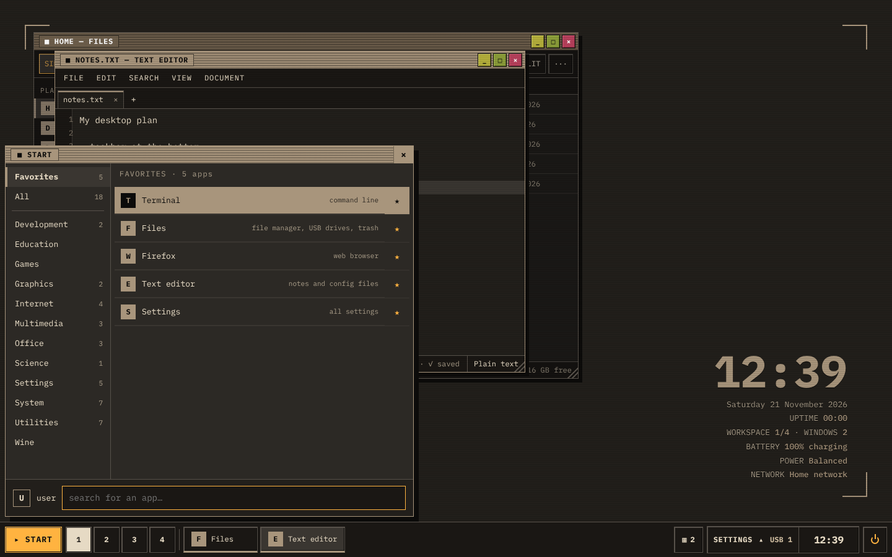
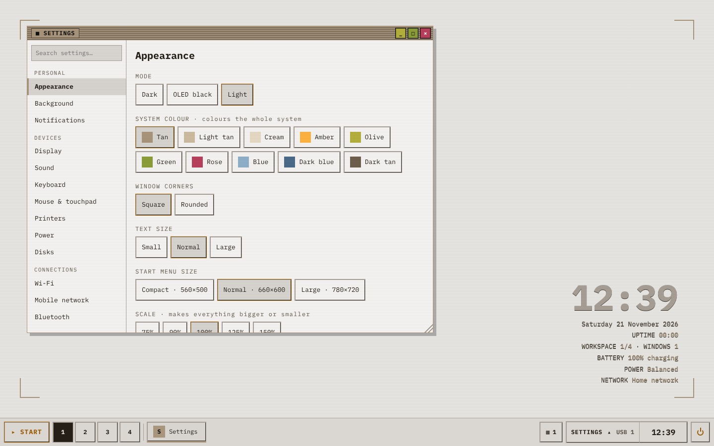
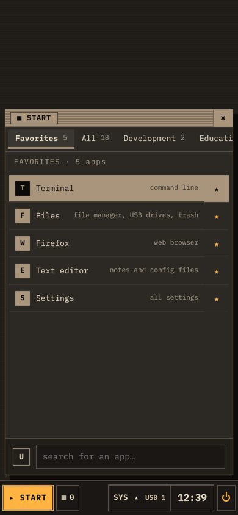
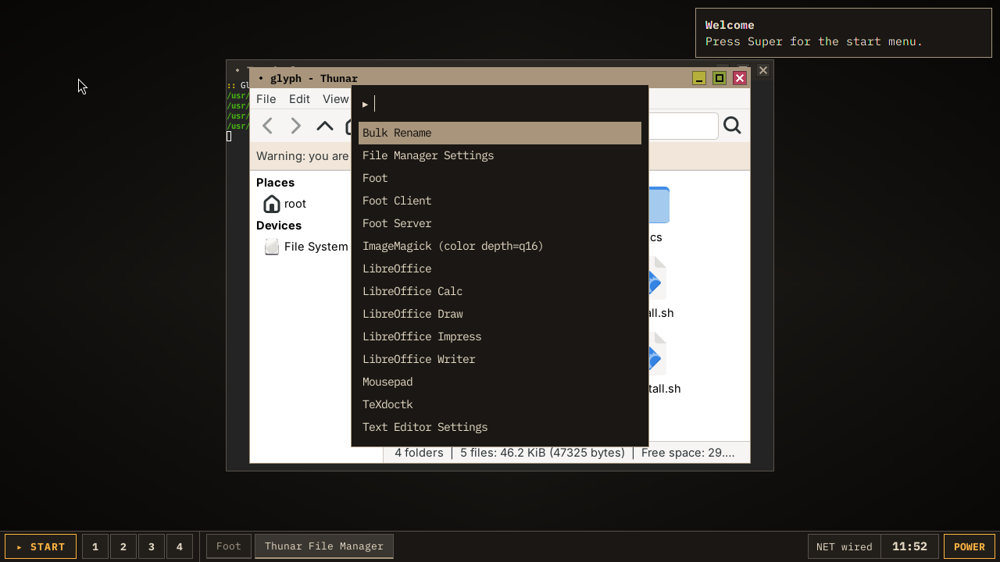
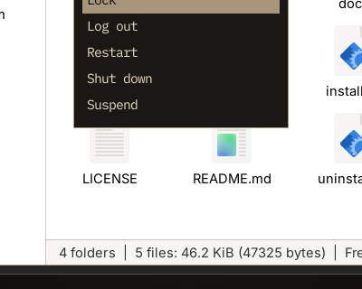
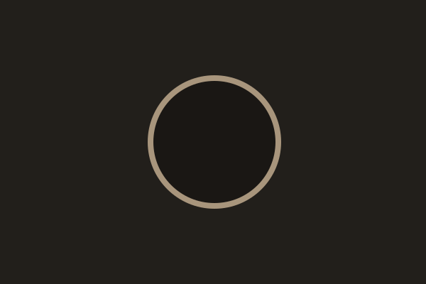
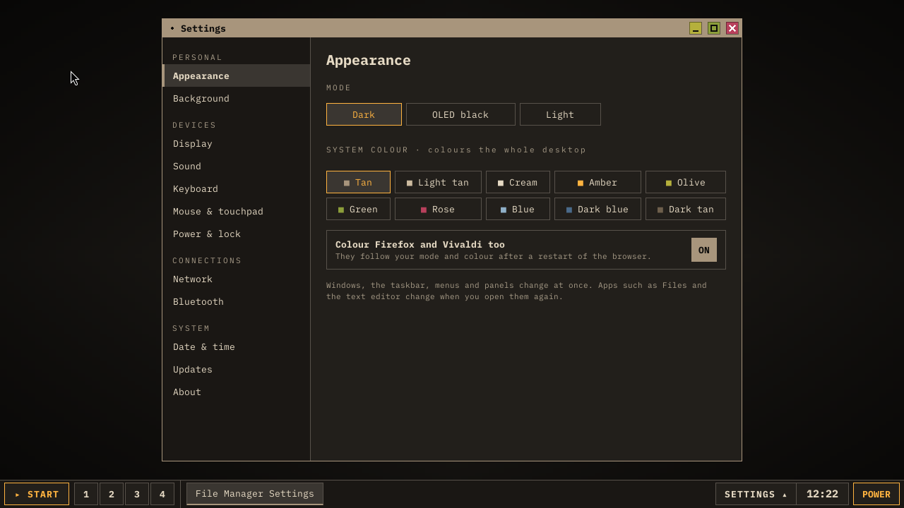
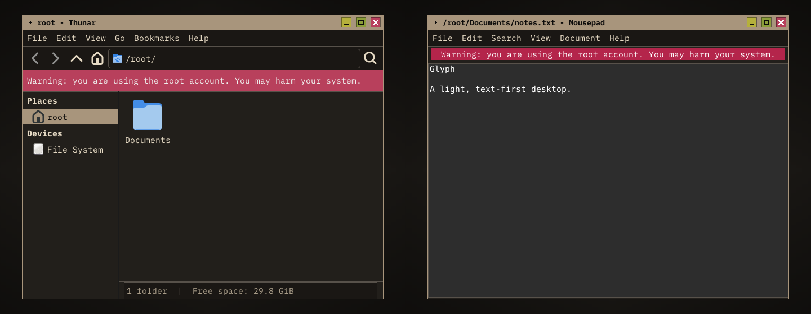

<div align="center">


**A light, text-first desktop for Debian 13. Letters, not logos.**

Debian 13 · labwc · Wayland · runs next to KDE, GNOME or XFCE · open source

[Try it](#-try-it-next-to-your-desktop) · [What you get](#-what-you-get) · [Roadmap](#-roadmap) · [Change the look](#-change-the-look) · [Update](#-update-and-remove)

</div>

## What is Glyph?

Glyph is a complete desktop for Debian, put together from small open-source parts instead of one big desktop environment. Everything looks the same: one font, square windows and one set of colours.

- **Text first.** Apps get a letter tile (**F** Files, **T** Terminal), not a logo. Menus and buttons are words.
- **One look everywhere.** IBM Plex Mono, square windows and the Glyph colours: Dark, OLED black or Light, with ten system colours. One settings file themes the windows, the taskbar and later your apps too.
- **Light.** labwc (Wayland) with a handful of small programs. No full desktop environment underneath.
- **Safe to try.** Glyph installs as an **extra session**. Your KDE, GNOME or XFCE stays exactly as it is, and `./uninstall.sh` removes Glyph again.

<div align="center">



<sub>The Glyph design: start menu, Files and the text editor. This is the prototype that the real desktop is built from, step by step.</sub>

</div>

## ✦ What you get

| Quick settings | Apps in the Glyph look |
|---|---|
|  |  |
| **Light mode and one system colour** | **First start** |
|  |  |

| Part | What it does |
|---|---|
| **Windows** | Square windows with a coloured title bar and **_ □ ×** buttons. Drag a window to an edge for half the screen, or to the top to maximize it. Four workspaces. |
| **Taskbar** | At the bottom: ▸ START, workspaces, your open windows, SETTINGS ▴ (network, volume, battery), the clock and POWER. |
| **Start menu** | Categories on the left, apps on the right. One search box finds apps, settings and files. |
| **Quick settings** | Wi-Fi, Bluetooth, mobile data, volume, brightness, power profile, night light, do not disturb and USB drives. |
| **Settings** | Appearance, display, sound, keyboard, mouse, printers, power, disks, users, date, language, privacy, default apps, accessibility and updates. |
| **Apps** | Files (Thunar), text editor (Mousepad), terminal (foot), image viewer (Ristretto), video (mpv), PDF (Atril), system monitor, software (apt + Flatpak), Firefox and Vivaldi. |
| **Start-up** | Boot menu, splash screen, first-start setup, login with a guest account and a lock screen. |

<div align="center">



<sub>Works with touch and keyboard, on a laptop and on a small screen.</sub>

</div>

## ▶ Try it (next to your desktop)

```sh
sudo apt install git
git clone https://github.com/DRetro83/glyph
cd glyph
./install.sh --check   # optional: only shows what it would do
./install.sh
```

Then log out. At the login screen, pick **Glyph** in the session list (in SDDM it is bottom left) and sign in. To go back, log out and pick your old desktop again.



<sub>Glyph running for real on labwc: the taskbar, the start menu (fuzzel) and a notification (mako).</sub>

| Power menu | Lock screen |
|---|---|
|  |  |

| Quick settings and calendar | Settings |
|---|---|
| Click **SETTINGS ▴** or the clock on the taskbar |  |

| Your apps in the Glyph look (Files, text editor) | Sign-in screen (optional) |
|---|---|
|  |  |

### Start-up look (optional)

The boot menu, the start-up screen and the sign-in screen are a separate step, because they change system files and also the sign-in screen that KDE uses:

```sh
extras/boot/install-boot.sh --check   # only shows what it would do
extras/boot/install-boot.sh           # GRUB + Plymouth + SDDM, or name only some: sddm grub plymouth
extras/boot/install-boot.sh --remove  # back to how it was
```

They take your Glyph colours at the moment you run it; run it again after you change the colour.

### Keys

| Do this | Keys |
|---|---|
| Start menu | tap Super, or Ctrl+Space, or click ▸ START |
| Power menu (lock, log out, restart, shut down) | click POWER, or Ctrl+Alt+Delete |
| Lock the screen | Ctrl+Alt+L or Super+L |
| Screenshot of the screen / an area | Print / Shift+Print (or Ctrl+Alt+P) |
| Open the desktop menu | right-click the desktop, or Ctrl+Alt+M |
| Terminal | Ctrl+Alt+T |
| Files | Super+E |
| Switch windows | Alt+Tab or Alt+Q |
| Left / right half | Super+← / → (or Ctrl+Alt+← / →), or drag to the edge |
| Maximize / restore | Super+↑ / ↓ (or Ctrl+Alt+↑ / ↓), or drag to the top |
| Close a window | Ctrl+Alt+W or Alt+F4 |
| Go to workspace 1–4 | Ctrl+Alt+1 … 4 |
| Move a window to workspace 1–4 | Shift+Ctrl+Alt+1 … 4 |
| Volume | volume keys, or Ctrl+Alt+PgUp / PgDn |

## 🗺 Roadmap

Glyph is built in six steps. Each step is tested before the next one starts. All six are built; the next thing is **your test on a real PC**.

| Step | What | Built with | Status |
|---|---|---|---|
| 1 | **Windows**: title bars, buttons, snapping, workspaces, right-click menu, the Glyph colours | labwc, glyph-theme | ✅ done |
| 2 | **Taskbar** at the bottom: START, workspaces, windows, volume, network, battery, clock, POWER | waybar | ✅ done |
| 3 | **Start menu, power menu, notifications, lock screen, screenshots** | fuzzel, mako, swaylock + swayidle, grim + slurp | ✅ done |
| 4 | **Quick settings, calendar and the Settings window** | GTK3 + gtk-layer-shell, NetworkManager, BlueZ, PipeWire, udisks2 | ✅ done |
| 5 | **Start-up and sign-in** (optional extra) | GRUB theme, Plymouth, SDDM theme | ✅ done |
| 6 | **Your apps in the Glyph look** | GTK 3/4 theme, qt6ct, foot, editor colours, Firefox and Vivaldi CSS | ✅ done |

After that: a **Glyph ISO** to try it from a USB stick, and a clean install without another desktop. Details in [docs/ROADMAP.md](docs/ROADMAP.md).

## 🎨 Change the look

**Settings → Appearance** (also: Background), right-click the desktop → **Look**, or from the terminal:

```sh
glyph-theme --mode dark      # dark | oled | light
glyph-theme --colour amber   # tan, light-tan, cream, amber, olive, green, rose, blue, dark-blue, dark-tan, or #rrggbb
glyph-theme --print          # show the whole palette
```

Windows, taskbar, menus and panels change at once; apps such as Files change when you open them again, and Firefox after a restart. Your choice is kept in `~/.config/glyph/theme.conf`.

Firefox gets the Glyph colours by itself. For **Vivaldi**: open `vivaldi://experiments`, turn on *Allow CSS modifications*, then in Vivaldi's Settings → Appearance → *Custom UI modifications* choose the folder `~/.config/glyph/vivaldi`. Don't want the browsers coloured? Turn it off in Settings → Appearance.

## ⟳ Update and remove

```sh
glyph-update               # newest Glyph from GitHub; your look and settings are kept
./uninstall.sh             # remove Glyph, keep the packages
./uninstall.sh --packages  # also remove labwc, swaybg …
```

<details>
<summary><b>What goes where</b></summary>

| Path | What |
|---|---|
| `~/.config/glyph/labwc/` | the window manager settings, only used in the Glyph session |
| `~/.config/glyph/theme.conf` | your mode and colour |
| `~/.local/share/themes/Glyph/` | the window and GTK theme that glyph-theme makes (used only in the Glyph session) |
| `~/.config/qt6ct/`, `~/.config/qt5ct/` | Qt colours, only read in the Glyph session |
| `~/.config/glyph/foot/glyph.ini`, `vivaldi/glyph.css` | terminal and Vivaldi colours; Firefox gets `chrome/userChrome.css` in its profile |
| `~/.config/glyph/glyph.conf` | lock time and screen scale from Settings |
| `~/.config/glyph/waybar/`, `fuzzel/`, `mako/`, `swaylock/` | taskbar, menus, notifications and lock screen; the colours are made by glyph-theme |
| `/usr/local/bin/glyph-*` | glyph-session, glyph-theme, glyph-settings, glyph-panel, glyph-bg, glyph-idle, glyph-update, glyph-menu, glyph-power, glyph-lock, glyph-shot, glyph-ws |
| `/usr/share/wayland-sessions/glyph.desktop` | the entry on the login screen |

</details>

## Built with

[labwc](https://labwc.github.io/) · [waybar](https://github.com/Alexays/Waybar) · [fuzzel](https://codeberg.org/dnkl/fuzzel) · [mako](https://github.com/emersion/mako) · [swaylock](https://github.com/swaywm/swaylock) · [foot](https://codeberg.org/dnkl/foot) · [Thunar](https://docs.xfce.org/xfce/thunar/start) · [Mousepad](https://docs.xfce.org/apps/mousepad/start) · [IBM Plex Mono](https://www.ibm.com/plex/) · [Debian](https://www.debian.org/)

## Licence

Glyph is GPL-3.0. IBM Plex is under the SIL Open Font License, labwc under GPL-2.0.
